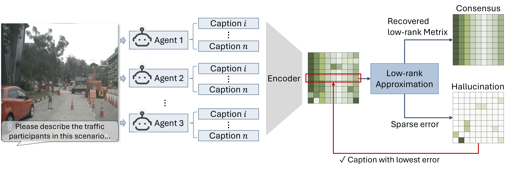

# Low-Rank Consensus for VLM Hallucination Mitigation in Autonomous Driving

**[Official paper](https://doi.org/10.1016/j.trc.2026.106092) · [Run the demo](#quick-demo-select-one-caption-from-ten) · [Core algorithm](demo.py) · [How to cite](#citation)**

**Official research code** for the paper:

**Keke Long, Jiacheng Guo, Tianyun Zhang, Hongkai Yu, and Xiaopeng Li.** "A low-rank consensus method for vision language model hallucination mitigation in autonomous driving." *Transportation Research Part C*, 194 (2027), 106092. [Paper / DOI](https://doi.org/10.1016/j.trc.2026.106092)

This work provides a lightweight, **training-free and reference-free caption selection method** for reducing hallucinations in vision-language model (VLM) descriptions of driving scenes. Given multiple candidate descriptions of the same image, it estimates their shared semantic structure and selects the caption with the smallest deviation from that consensus. The selection step needs only the candidate captions, not the original image, ground-truth labels, or internal VLM representations.



**Figure 2.** Overview of Low-Rank Consensus. Candidate captions for the same scene are encoded into a matrix; low-rank reconstruction captures their shared semantic structure, and the caption with the smallest reconstruction residual is selected. The SVD implementation does not explicitly impose entrywise sparsity on the residual.

## Highlights

- **Black-box compatibility:** Works with captions from one or multiple VLMs, without modifying or retraining their parameters.
- **Low-rank semantic consensus:** Uses sentence embeddings, truncated singular value decomposition (SVD), and caption-wise residual norms.
- **Adaptive rank:** Uses a gated spectral-gap rule to choose the retained rank for each scene.
- **Paper results:** 87% hallucination-free caption selection accuracy on the evaluated NuScenes scenes in the heterogeneous multi-VLM setting, versus 79%–82% for the tested multi-agent debate baselines. Reported inference time was 0.84 s per scene, compared with 1.72–2.56 s for debate under the paper's evaluation conditions. These are paper results, not measurements from a new checkout.

## Quick demo: select one caption from ten

**Start with [`demo.py`](demo.py).** This single file contains the core algorithm and ten illustrative captions for one traffic scene. It encodes the captions, selects a rank, computes the reconstruction residuals, and prints the selected caption, retained rank, and score for each candidate.

If you use this code or the Low-Rank Consensus method in your research, please [cite our paper](#citation).

Clone the repository and run the demo in your Python environment:

```bash
git clone https://github.com/Keke-Long/Low-rank-Consensus.git
cd Low-rank-Consensus
python -m pip install numpy sentence-transformers
python demo.py
```

The demo uses `intfloat/e5-large-v2` on **CPU**. The first run downloads the sentence encoder from Hugging Face; later runs reuse its local cache. Installation and the initial model download require internet access. No API key, NuScenes dataset, image, VLM deployment, or ground-truth labels are required.

To try your own scene, replace `CAPTIONS` in `demo.py` with your candidate descriptions of the **same image**. The `select_caption()` function returns `best_caption`, its zero-based `best_index`, the selected `rank`, and `residuals` in the original input order. You can also import this function directly from `demo.py`.

```python
from demo import CAPTIONS, select_caption

result = select_caption(CAPTIONS)  # Replace CAPTIONS with your own list of captions.
print(result["best_caption"])
print(result["rank"])
print(result["residuals"])
```

These hand-written captions demonstrate usage; they are not benchmark data. The demo selects the lowest-residual candidate under the method. It does not perform factual verification or report hallucination accuracy.

## Method

Given `n` candidate captions for one scene, encode each caption as a `d`-dimensional vector and stack them into the matrix `M`:

```text
Candidate captions -> Sentence embeddings (M)
                   -> Truncated SVD -> Low-rank reconstruction (R)
                   -> Residual E = M - R
                   -> Score each caption by ||E[i]||_2
                   -> Select the caption with the smallest score
```

The rank is selected using a **gated spectral gap**: if the first-to-second singular-value ratio is at least `4.75`, choose rank 1. Otherwise, compare the available gaps for ranks 2, 3, and 4, choose the rank with the largest gap, and then cap it at `3`. The demo preserves the main experiment script's raw-text encoding, unnormalized embeddings, and uncentered SVD.

A smaller residual indicates **stronger agreement with the candidate set**, not a guarantee of factual correctness. Shared hallucinations may enter the consensus, and correct but unusual details may receive larger residual scores.

## Run the original CSV experiment

For inference from a caption list, use the demo above. The original experiment script operates on **already generated caption CSVs** and also calculates evaluation summaries.

1. Clone the repository and create a Python environment. `environment.yaml` records the original research environment; some pinned CUDA/PyTorch dependencies are platform-specific, so a fresh installation may require adjustments.
2. Install the Python dependencies used by the selection stage, including `numpy`, `pandas`, `torch`, and `sentence-transformers`. The sentence encoder used for the experiments is [`intfloat/e5-large-v2`](https://huggingface.co/intfloat/e5-large-v2).
3. Supply one CSV file per scene in `Nuscenes/results_caption/` (or pass your own input directory). The experiment script requires the columns `Model`, `Caption`, and `hallucination_check`, with model identifiers matching those in `MODEL_SAMPLE_COUNTS` in the script. Missing or invalid evaluation labels are not handled reliably by this original script; use properly annotated inputs for its accuracy summaries.
4. Run the main selector from the repository root:

```bash
python Nuscenes/process/gated_spectral_gap_select.py \
  --results-dir Nuscenes/results_caption \
  --output-dir Nuscenes/results/gated_spectral_gap_main \
  --gate 4.75 \
  --max-rank 3
```

Outputs include per-scene selected captions, chosen ranks, and evaluation summaries.

**Input assumptions:** The script currently selects the first four `deepseek-vl2-tiny` captions, three `Qwen2-VL-7B-Instruct` captions, and three `llava-1.5-7b-hf` captions per scene. The input CSVs and precomputed labels are **not included** in this repository. The standalone demo accepts captions directly without model-name quotas or evaluation labels.

### Full NuScenes experiment

To regenerate VLM captions and evaluation annotations, separately obtain [NuScenes](https://www.nuscenes.org/) (the paper uses `v1.0-trainval`), configure local paths using `.env.example`, and run the relevant VLM generation and evaluation scripts. For example:

```bash
cp .env.example .env
# Edit .env to set NUSCENES_DIR to your own dataset directory.
```

Model downloads, substantial GPU resources, and environment-specific adjustments may be required. Check the paper's experimental configuration before reproducing the reported numbers: **some generation scripts currently default to temperature 0.4**, while the paper describes temperature 0.7 and up to 150 tokens. Generation prompts and per-script limits should also be checked against the published setup before making a strict reproduction claim.

**Data availability:** The repository does not include NuScenes images, caption CSVs, generated evaluation labels, or full experiment outputs. The code is provided as a research implementation; the complete published experiment is not yet a one-command reproduction pipeline.

## Citation

If you use this code or the Low-Rank Consensus method in your research, please cite our paper:

Keke Long, Jiacheng Guo, Tianyun Zhang, Hongkai Yu, and Xiaopeng Li. **A low-rank consensus method for vision language model hallucination mitigation in autonomous driving.** *Transportation Research Part C: Emerging Technologies*, 194, 106092, 2027. [https://doi.org/10.1016/j.trc.2026.106092](https://doi.org/10.1016/j.trc.2026.106092)

```bibtex
@article{long2027lowrank,
  title   = {A low-rank consensus method for vision language model hallucination mitigation in autonomous driving},
  author  = {Long, Keke and Guo, Jiacheng and Zhang, Tianyun and Yu, Hongkai and Li, Xiaopeng},
  journal = {Transportation Research Part C: Emerging Technologies},
  volume  = {194},
  pages   = {106092},
  year    = {2027},
  doi     = {10.1016/j.trc.2026.106092},
  url     = {https://doi.org/10.1016/j.trc.2026.106092}
}
```

## License

The source code is released under the [MIT License](LICENSE). The paper and Figure 2 are not covered by this code license; datasets and third-party models retain their respective licenses.
